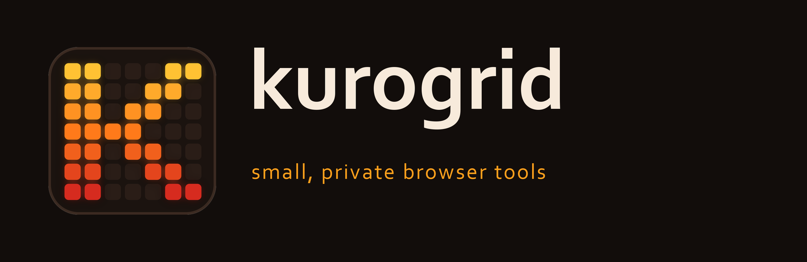
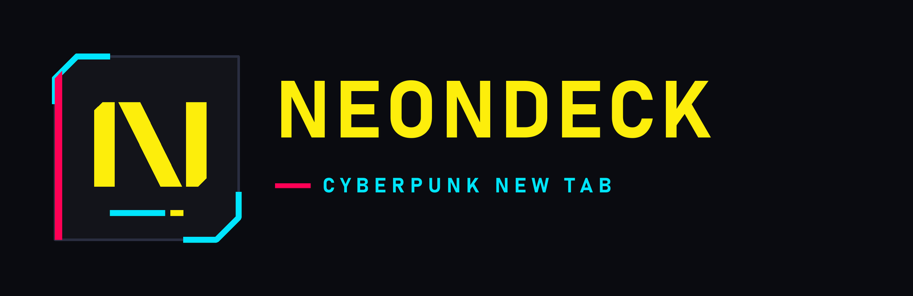

  <a href="https://kurogrid.github.io/">
    <picture>
      <source media="(prefers-color-scheme: dark)" srcset="./kurogrid-logo-dark.png">
      <source media="(prefers-color-scheme: light)" srcset="./kurogrid-logo-light.png">
      
    </picture>
  </a>

  
  
  

<table>
  <tr>
    <td width="33%" valign="top"><b>Private by default</b> Everything runs in your browser. No accounts, no analytics, no servers of ours.</td>
    <td width="33%" valign="top"><b>Open source</b> Code is public under MIT and builds reproducibly from source.</td>
    <td width="33%" valign="top"><b>Made to look good</b> Careful themes and typography, as few permissions as possible.</td>
  </tr>
</table>

### Projects

**NEONDECK** · a cyberpunk HUD new tab for Firefox and Chrome: big clock, multi-engine search, netlinks and a widget panel. `0.1.0 alpha`

[Website](https://kurogrid.github.io/neondeck/) · [Source](https://github.com/Kurogrid/neondeck-extension) · [Download alpha](https://github.com/Kurogrid/neondeck-extension/releases) · [Privacy](https://kurogrid.github.io/neondeck/privacy)

---

More projects are on the way. · Tarayıcı eklentileri ve temalar, Türkçe ve İngilizce arayüz.
